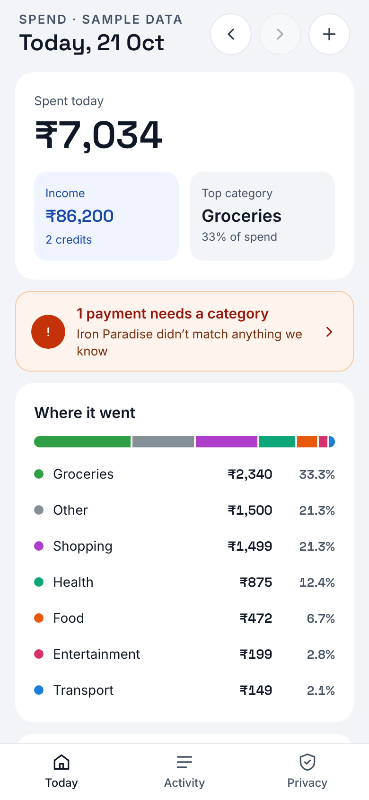
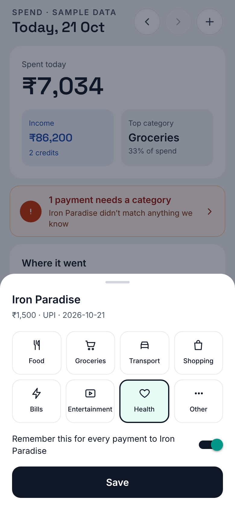
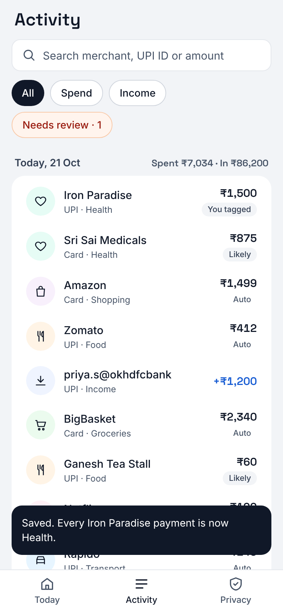
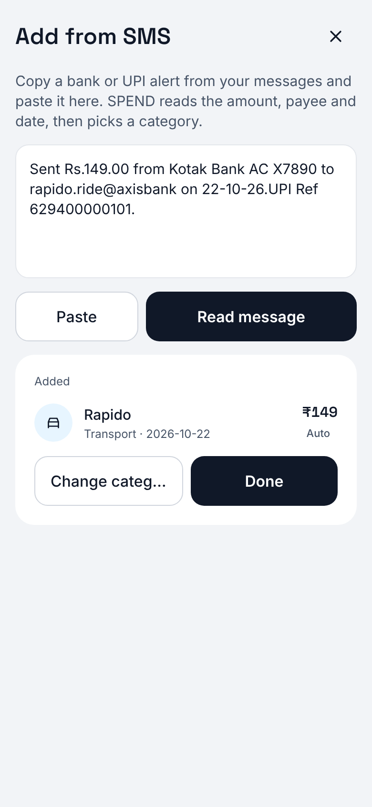

# SPEND mobile app

React Native (Expo SDK 58, Expo Router, TypeScript), Android-first. It
implements the screens from the design canvas (`../design/project/`).

| Today | Re-tag | Activity | Add from SMS |
|---|---|---|---|
|  |  |  |  |

## Run it

New to this? Follow the step-by-step guide in
[`../docs/RUNNING.md`](../docs/RUNNING.md).

```bash
npm install
npm run android        # Expo dev server + Android emulator/device (Expo Go)
npm run web            # same app in a browser
```

The app starts on onboarding. Pick **Try with sample data** to explore with
fictional transactions and no server. Pick **Continue** to use live mode:
start the engine from the repository root first.

```bash
# from the repo root
pip install -e ".[dev]"
SPEND_DB=spend.db uvicorn spend_engine.api:app --host 0.0.0.0 --port 8000
```

The app's default server address is `http://10.0.2.2:8000` on the Android
emulator (the host machine) and `http://localhost:8000` elsewhere. Set
`EXPO_PUBLIC_SPEND_API_URL` for a phone on your Wi-Fi, e.g.
`http://192.168.1.20:8000`, or change it in the Privacy tab. For the browser
build, allow its origin on the engine with
`SPEND_CORS_ORIGINS=http://localhost:8081`, which is the default.

## Checks

```bash
npm run typecheck
npm run lint
npm test
npm run export:web     # production web build into dist/
```

## What's in this version

* **Onboarding**: data-source choice. Bank linking (Account Aggregator) and
  SMS reading are shown as unavailable. The first is not built yet; the second
  waits on Google Play's SMS-permission decision (see `../docs/PLAN.md` §3).
* **Today**: spend, income, top category, a needs-review card, a category
  breakdown and the day's payments. Step back and forward by day, and pull to
  refresh.
* **Re-tag sheet**: pick a category and optionally "remember for every
  payment to X". This calls `POST /corrections`, and the totals update.
* **Activity**: the last 30 days grouped by day, with search (merchant, UPI
  ID, amount, category) and filters (All / Spend / Income / Needs review).
* **Add from SMS**: paste a bank alert. The engine parses and categorises it,
  and OTPs, offers and failed payments are rejected with a reason.
* **Privacy**: what the app does with data, switching between sample and
  live data, the server address, and reset.

## Layout

```
src/app/                 routes (Expo Router)
  _layout.tsx            fonts, app state, root stack, toast
  onboarding.tsx
  (tabs)/index.tsx       Today
  (tabs)/activity.tsx
  (tabs)/privacy.tsx
  retag/[id].tsx         transparent modal sheet
  add.tsx                modal
src/components/          UI pieces (TransactionRow, CategoryBreakdown, ...)
src/lib/
  repository.ts          SpendRepository interface + error messages
  api.ts                 live mode: spend_engine HTTP client
  sample.ts              sample mode: in-memory fictional data, same rules
  summary.ts             daily summary (port of spend_engine.summary)
  app-state.tsx          settings (AsyncStorage), mode, refresh, toast
  use-data.ts            data hooks for screens
  format.ts, filter.ts   ₹ formatting (Indian grouping), dates, chips, search
  theme.ts               design tokens and category colours/icons
__tests__/               Jest (jest-expo) + Testing Library
```

## Not built yet

* Receiving shared SMS from the Messages app (Android share intent). This
  needs a config plugin and a development build, not Expo Go.
* Account Aggregator linking, which needs an AA partner.
* SMS reading, gated on Google Play.
* Offline parsing on the phone. Today, live mode sends pasted SMS text to your
  SPEND server; a TypeScript port of the parser would keep it on the device.
* Auth: the app identifies itself with a random per-install user ID. The
  engine has no authentication, so run it only on a trusted network.
